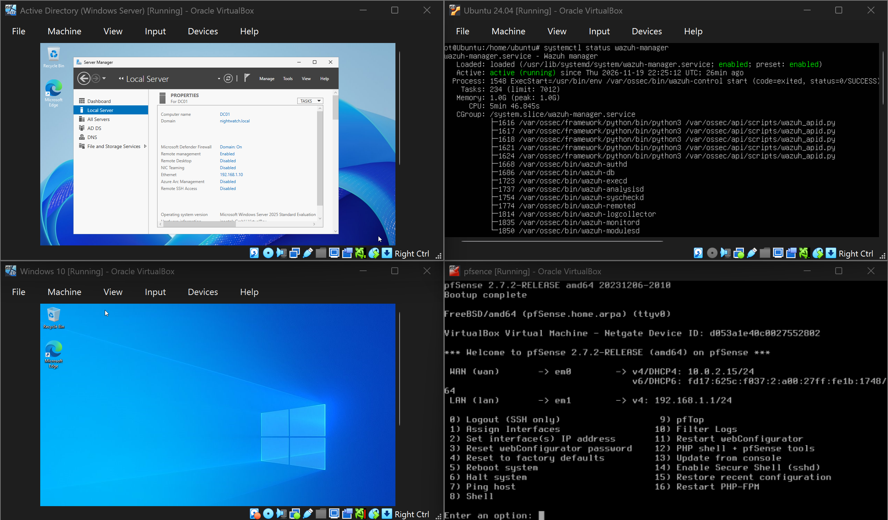

# AD-PurpleTeam-Wazuh-Lab

> A self-built, fully isolated **Active Directory purple-team lab** — taken from zero access to **Domain Admin**, with every stage of the intrusion captured and mapped in a **Wazuh** SIEM.



## What this is

`nightwatch.local` is a virtualized enterprise Active Directory network built on Oracle VirtualBox to practise and **detect** real-world AD attacks. Using an **assume-breach** model, I ran a full attack chain against a hardened Windows Server 2025 domain while a centralized Wazuh v4.14.10 SIEM collected endpoint telemetry and alerted on each step.

The focus is the defender's question: **what does each attack look like in the logs, and which ones actually fire an alert?**

**Stack:** pfSense 2.7.2 · Windows Server 2025 (DC) · Windows 10 Pro (client) · Kali Linux 2024.4 (attacker) · Wazuh 4.14.10 on Ubuntu Server 24.04 (SIEM).

## Repo contents

| File | What's inside |
| --- | --- |
| [`docs/01-lab-architecture-setup.md`](docs/01-lab-architecture-setup.md) | VirtualBox, pfSense, DC01, CLIENT01 and Wazuh build & hardening guide |
| [`docs/02-red-team-attack-chain.md`](docs/02-red-team-attack-chain.md) | Full attack chain: Nmap, LDAP/SMB/Kerberos enumeration, spraying, DCSync, PtH, Golden Ticket |
| [`docs/03-blue-team-detections.md`](docs/03-blue-team-detections.md) | Wazuh alerts, Event IDs, MITRE mapping, CIS benchmark & remediation |
| [`configs-and-logs/`](configs-and-logs/) | Sanitized command outputs, Nmap scans, Wazuh JSON alert samples |

## The attack chain at a glance

```
Recon ─> Enumeration ─> Password Spray ─> DCSync ─> Pass-the-Hash ─> Golden Ticket
                                                          │
                                              Full Domain Compromise
```

## Detection summary

Across the test window Wazuh recorded **2,737 alerts** (2 High, 759 Medium, 1,976 Low).

| Attack phase | Windows Event | Wazuh rule / level | MITRE ATT&CK |
| --- | --- | --- | --- |
| Brute force / spray | `4625` | `60122` / 5 | T1110 |
| Account lockout | `4740` | `60115` / 9 | T1110, T1531 |
| SMB enumeration | `5140` | `67017` / 3 | T1021.002 |
| Pass-the-hash logon | `4624` | `92657` / 6 | T1550.002, T1078.002 |
| **PsExec service execution** | `7045` | `92650` / **12 (High)** | T1021.002, T1569.002 |

Full detail, including the DCSync audit gap, is in [`docs/03-blue-team-detections.md`](docs/03-blue-team-detections.md).

## Key takeaways

- A complete, realistic AD kill chain executed and **detected** end to end.
- Modern gotchas handled: **Server 2025 rejects RC4** Golden Tickets (re-forged with AES256), and **Kerberos clock-skew** had to be fixed before tickets were accepted.
- Honest reporting: DCSync (`4662`) went **undetected** because Directory Service Access auditing was off — documented as a finding with the fix.

## Disclaimer

`nightwatch.local` is a private, fully isolated lab that I own and built solely for education. All accounts, data, and credentials are fabricated. Every weakness shown was configured deliberately. No system was accessed without authorization.

## License

[MIT](LICENSE)
