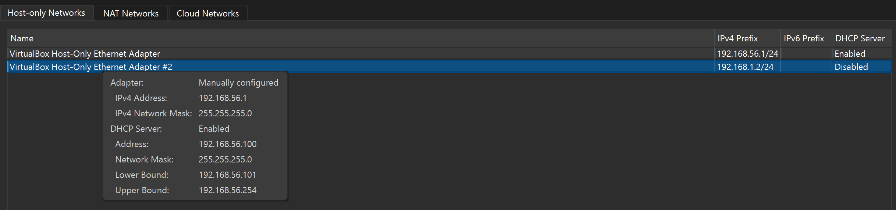
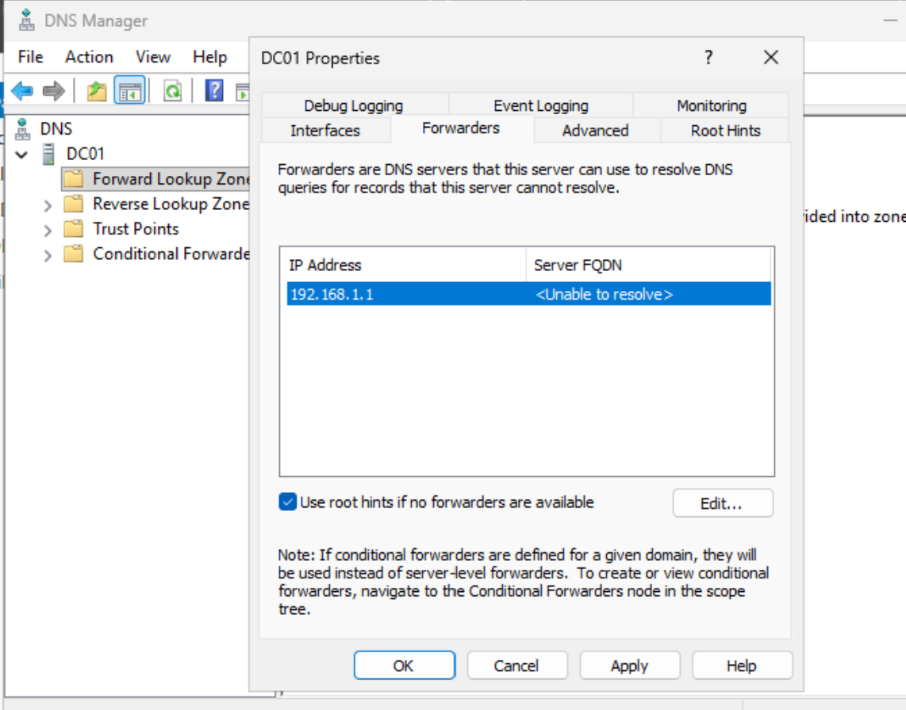
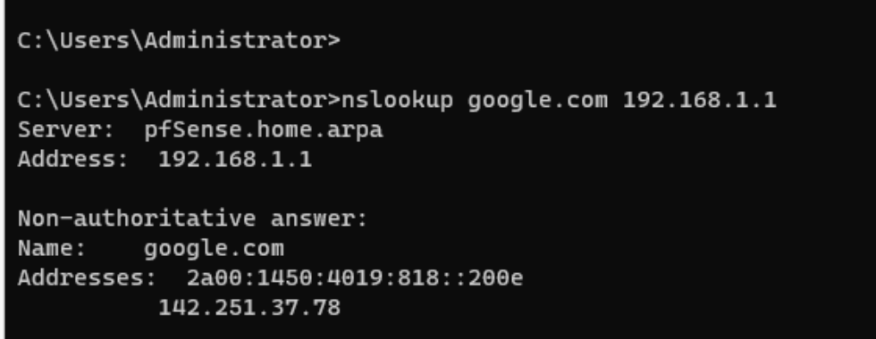
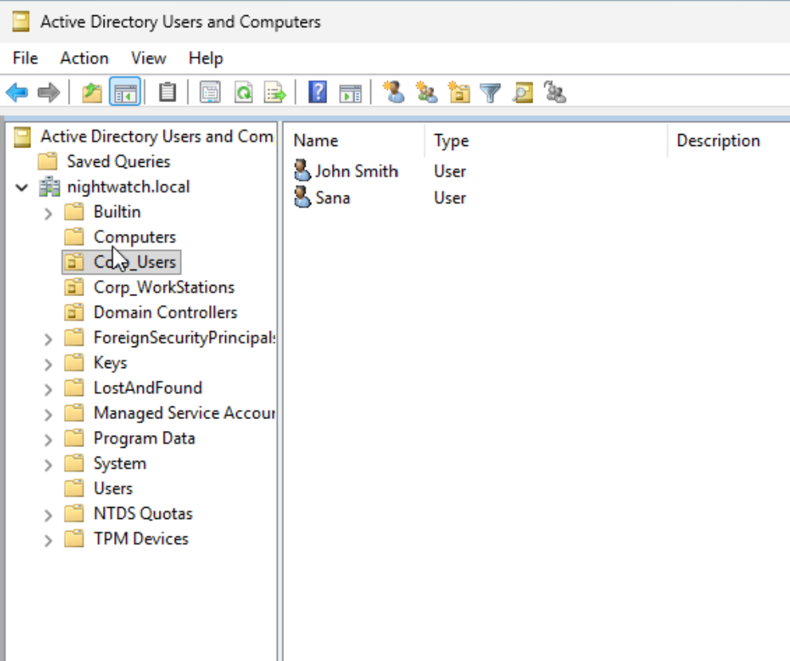
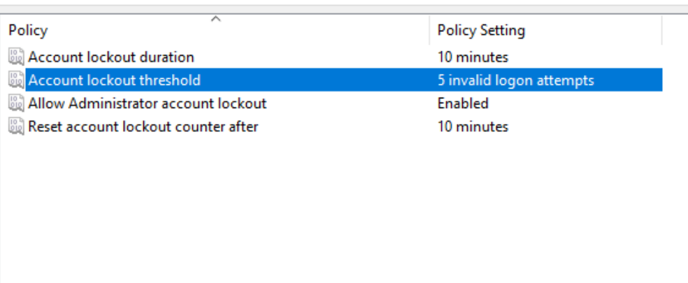
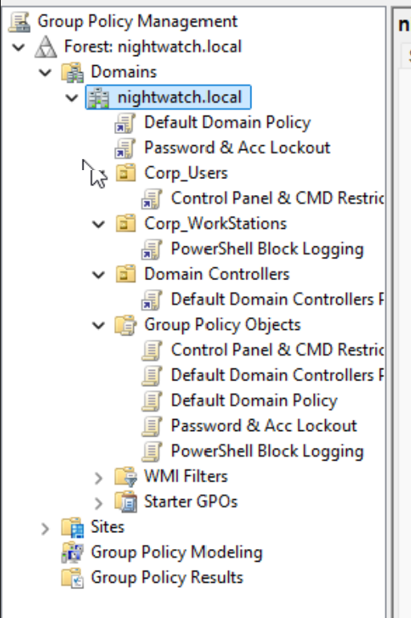
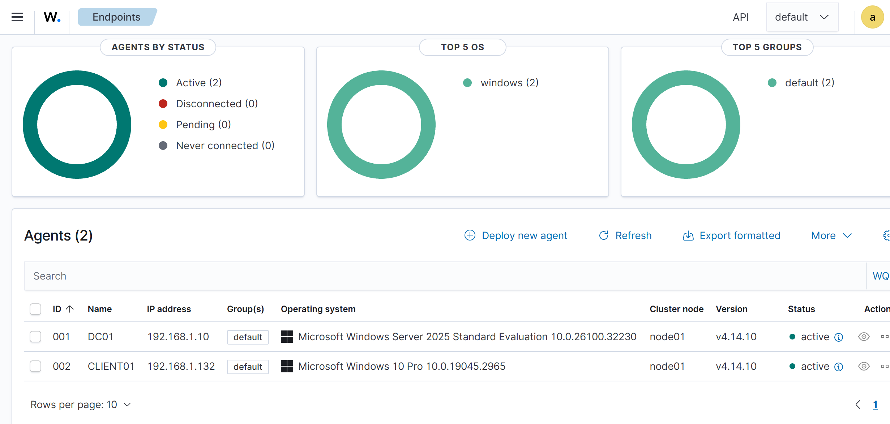

# 01 — Lab Architecture & Setup

This document covers the full build of the `nightwatch.local` environment: the virtual network, pfSense, the domain controller, the workstation, and the Wazuh SIEM.

## 1. Virtual network

All machines sit on a single isolated `192.168.1.0/24` network behind pfSense, on a VirtualBox **Host-Only** adapter (`VirtualBox Host-Only Ethernet Adapter #2`) with its built-in DHCP **disabled** — pfSense provides DHCP and DNS instead.

- **Host:** Windows workstation, 32 GB RAM, Oracle VirtualBox.
- **Host-Only adapter:** `192.168.1.0/24`, host address `192.168.1.2`, VirtualBox DHCP disabled.

### Adapter plan

| VM | Adapter 1 | Adapter 2 |
| --- | --- | --- |
| pfSense | NAT (WAN) | Host-Only (LAN, `192.168.1.1`) |
| DC01 | Host-Only | — |
| CLIENT01 | Host-Only | — |
| Wazuh | Host-Only | — |
| Kali | Host-Only | — |

### IP plan

| Machine | IP | Gateway | DNS |
| --- | --- | --- | --- |
| pfSense LAN | `192.168.1.1` | — | — |
| DC01 | `192.168.1.10` (static) | `192.168.1.1` | `127.0.0.1` |
| Wazuh | `192.168.1.20` (static) | `192.168.1.1` | `192.168.1.10` |
| CLIENT01 | DHCP | `192.168.1.1` | `192.168.1.10` |
| Kali | DHCP | `192.168.1.1` | `192.168.1.10` |

> **Critical rule:** every domain machine uses `DC01` (`192.168.1.10`) as its DNS server — Active Directory depends on it. `DC01` points its own DNS to itself and forwards external lookups to pfSense.

## 2. pfSense

- **WAN (`em0`):** NAT, `10.0.2.15/24` — upstream internet for updates.
- **LAN (`em1`):** Host-Only, `192.168.1.1/24`.
- **DHCP server:** enabled on LAN, pool `192.168.1.100–192.168.1.200`, with a static MAC reservation for `DC01` → `192.168.1.10`, and the DNS option pointing clients to `192.168.1.10`.
- **DNS Resolver (Unbound):** enabled across all interfaces to forward from `DC01`.

## 3. Domain controller (DC01)

- Set hostname `DC01`, timezone Karachi (UTC+5), static IP `192.168.1.10/24`, DNS `127.0.0.1`, disabled IPv6.
- Installed **AD DS** and **DNS Server** roles; promoted `DC01` to the forest root of `nightwatch.local` (functional level 2016).
- Configured a DNS forwarder to `192.168.1.1` and verified `nslookup google.com`.

### Organizational units & accounts

- **OUs:** `Corp_Users`, `Corp_WorkStations`.
- **Accounts (10):** built-in (`Administrator`, `Guest`, `krbtgt`), standard users (`j_smith`, `sana`, `a_khan`, `m_ali`, `r_fatima`, `b_ahmed`), service account (`svc_sql`), plus the computer accounts `DC01$` and `CLIENT01$`.

## 4. Group Policy (hardening)

| GPO | Scope | Settings |
| --- | --- | --- |
| Password & Account Lockout | Domain root | Min length 7; lockout threshold 5; duration 10 min; reset counter 10 min; admin lockout enabled |
| Control Panel & CMD Restriction | Corp_Users / Corp_WorkStations | Block `cmd.exe` and settings for standard users |
| PowerShell Block Logging | Corp_WorkStations | Script Block Logging on |
| Advanced Audit Policy | Domain Controllers | Success/Failure for File Share + Kerberos Service Ticket operations |

> **Known audit gap:** *Directory Service Access* auditing was left off, so DCSync (`4662`) is not logged. This is intentional and documented as a finding in [03-blue-team-detections.md](03-blue-team-detections.md).

## 5. Wazuh SIEM

- Deployed Wazuh **v4.14.10** all-in-one on Ubuntu Server 24.04 at `192.168.1.20`.
- **Troubleshooting note:** the initial all-in-one install hit host memory exhaustion (concurrent VMs using ~28.7/31.3 GB), causing RCU stalls and `systemd` timeouts on the indexer/manager. Rebalancing VM memory allocations resolved it.
- Enrolled Windows agents via PowerShell and verified heartbeats:
  - Agent `001` — `DC01` — `active`
  - Agent `002` — `CLIENT01` — `active`

## Build order recap

1. Host-Only network (DHCP off) → pfSense (WAN NAT + LAN Host-Only, DHCP/DNS).
2. DC01 static IP + rename + timezone → promote to DC → OUs, users, GPOs.
3. CLIENT01 (Win10 Pro) joined to the domain.
4. Wazuh server → enroll both Windows agents.
5. Kali on the Host-Only network as the attacker.
