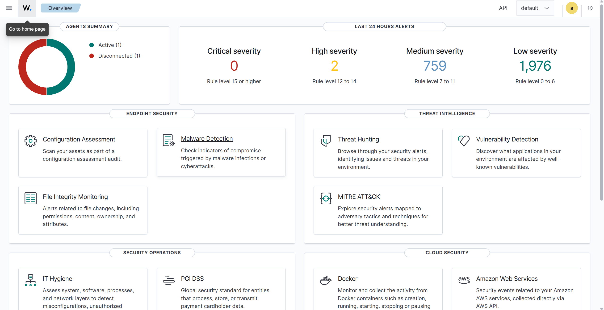
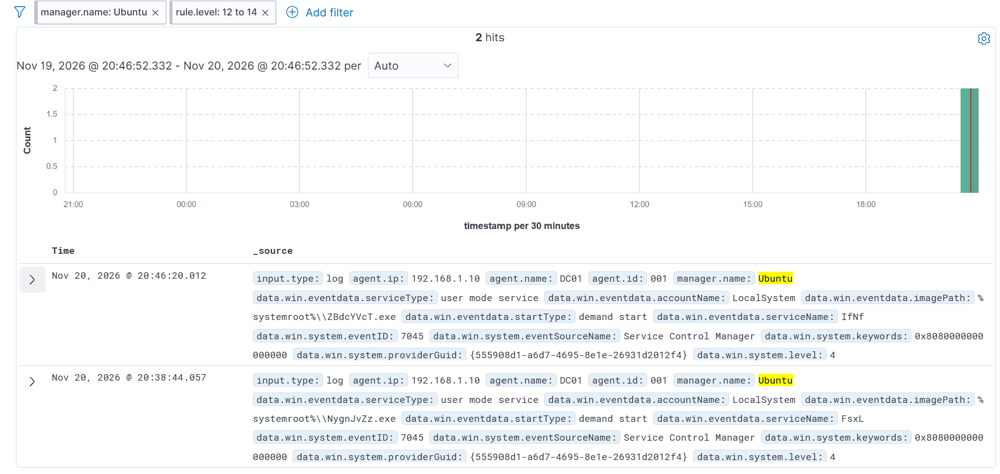
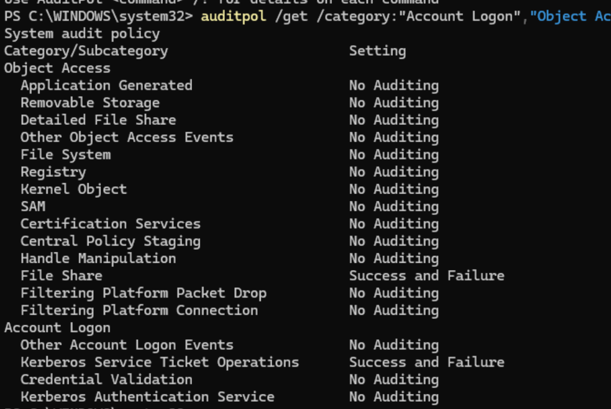
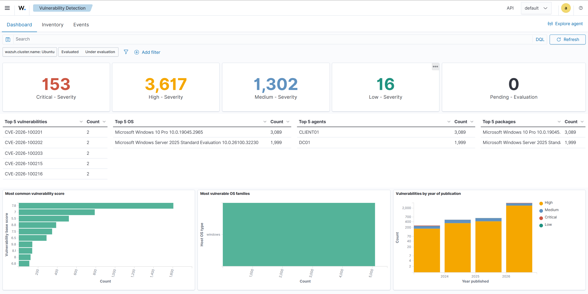
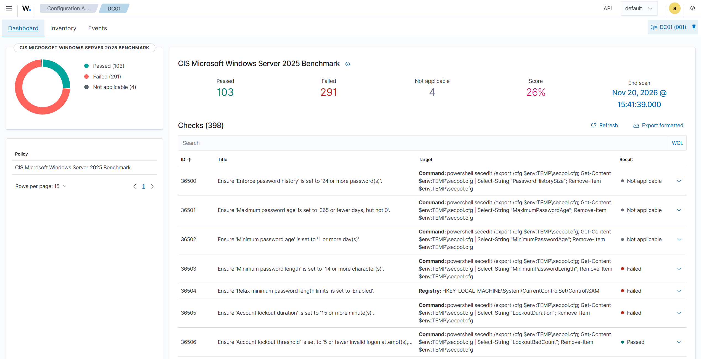

# 03 — Blue Team Detections & Posture

How each attack appeared in Wazuh, what fired, what didn't, and how a defender would fix the gaps.

## 1. Alert summary

Across the test window Wazuh recorded **2,737 alerts**: **2 High** (level 12–14), **759 Medium** (level 7–11), **1,976 Low** (level 0–6).

## 2. Attack-to-detection mapping

| Attack phase | Windows Event | Wazuh rule / level | MITRE ATT&CK | Telemetry |
| --- | --- | --- | --- | --- |
| Brute force / spray | `4625` | `60122` / 5 | T1110 | Failed NTLM Type-3 logons from `192.168.1.130` (KALI) |
| Account lockout | `4740` | `60115` / 9 | T1110, T1531 | `j_smith` locked out; caller `KALI` |
| SMB enumeration | `5140` | `67017` / 3 | T1021.002 | Repeated `IPC$` / `SYSVOL` access from the sprayed users |
| Pass-the-hash logon | `4624` | `92657` / 6 | T1550.002, T1078.002 | NTLMv2 Type-3 logon, elevated token |
| **PsExec service execution** | `7045` | `92650` / **12 (High)** | T1021.002, T1569.002 | `LocalSystem` services `FsxL` / `IfNf` under `%systemroot%` |

The two **level-12** alerts are the two PsExec runs — pass-the-hash and Golden Ticket — each dropping a random-named service executable.

## 3. Detection gap: DCSync not alerted

DCSync (`4662`) produced **no alert**, because *Directory Service Access* auditing was not enabled on the DC. `auditpol` confirms Object Access covers File Share but not Directory Service Access, and Account Logon covers Kerberos Service Ticket Operations only.

**Fix:** enable Directory Service Access (Success/Failure) auditing so `4662` replication requests are logged, then alert when the requester is not a domain controller. This would have caught the single most damaging step in the chain.

## 4. Posture assessment

### Vulnerability detection
5,088 findings across both Windows endpoints: **153 Critical, 3,617 High**, 1,302 Medium, 16 Low. `CLIENT01` accounted for 3,089; `DC01` for 1,999. A realistic unpatched baseline.

### CIS Microsoft Windows Server 2025 Benchmark (DC01)
Overall score **26%** (103 passed / 291 failed / 4 N/A of 398 checks).

| Check | Setting | Result |
| --- | --- | --- |
| 36506 — Lockout threshold ≤ 5 | 5 attempts | Passed |
| 36503 — Min password length ≥ 14 | 7 | **Failed** |
| 36505 — Lockout duration ≥ 15 min | 10 min | **Failed** |
| 36500–36502 — Password history / age | Not Defined | **Failed / N/A** |

The failing controls line up exactly with the weaknesses planted for the attack chain.

## 5. Remediation roadmap

| Finding | Remediation |
| --- | --- |
| DCSync by a non-DC account | Remove replication rights from `a_khan`; alert on `4662` from non-DCs |
| DCSync undetected | Enable Directory Service Access auditing |
| Shared / weak passwords | Enforce 14+ chars, complexity, history (24), banned-password filtering |
| Weak lockout duration | Raise 10 → 15 minutes (CIS 36505) |
| Kerberoastable `svc_sql` | gMSA or long random password; alert on `4769` RC4 |
| AS-REP roasting | Never disable Kerberos pre-auth; alert on `4768` without pre-auth |
| Pass-the-hash | Tier admin accounts, enable Credential Guard; alert on `7045` + anomalous NTLM `4624` |
| Golden Ticket | Rotate `krbtgt` twice; limit Domain Admin membership |
| No LDAPS | Deploy AD CS; require signed/encrypted LDAP |
| Unpatched baseline | Apply cumulative updates to clear Critical/High CVEs |

**Bottom line:** a real SOC would have caught this chain early — at the spray/lockout stage, and (with DS auditing on) at DCSync — which is exactly what these detections show, gaps included.
